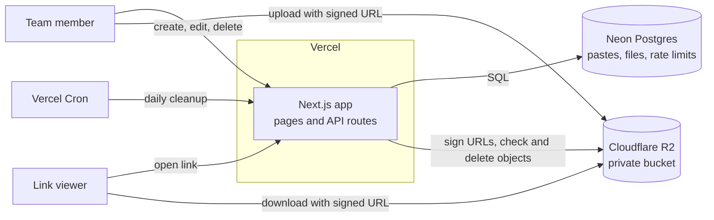
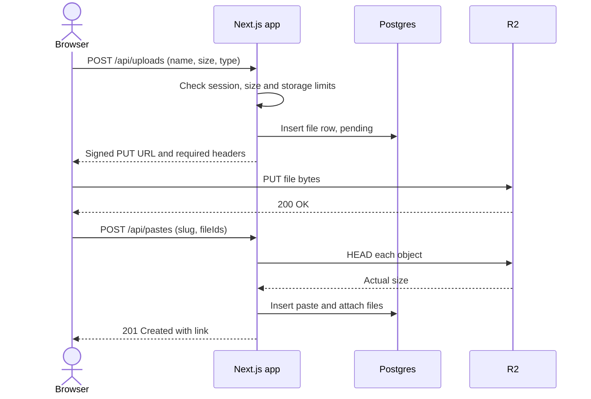
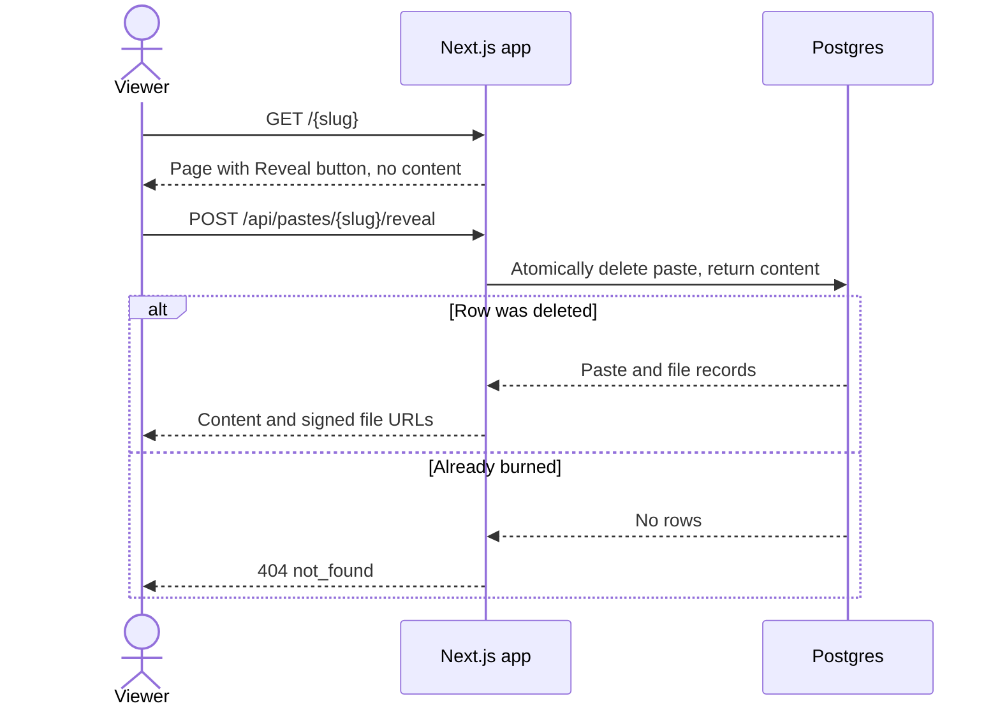

# Architecture

Pastekar is one Next.js app on Vercel, backed by Neon Postgres and a private Cloudflare R2 bucket.

## Goals

- A team member can share text or a file at a route they choose in under a minute.
- Anyone with a link can view it without an account.
- Strangers can't create pastes.
- Running costs stay near zero at team scale, with no servers to maintain.

Accounts, per-user permissions, public paste listings and search are out of scope.

## System overview



## Components

| Component | Responsibility |
|---|---|
| **Next.js app** | Renders pages, validates input, enforces all access rules, and issues signed URLs |
| **Neon Postgres** | Stores paste metadata, text content, file records and rate-limit counters |
| **Cloudflare R2** | Stores file bytes in a private bucket, reachable only through signed URLs |
| **Vercel Cron** | Calls the cleanup route on a schedule |

### Why these choices

- **Vercel's filesystem isn't persistent,** so data has to live in external services.
- **Postgres fits the access pattern.** Slug uniqueness and burn-after-read both depend on atomic database operations.
- **A private bucket keeps rules enforceable.** Vercel Blob was the simpler alternative, but with R2 every file link is short-lived and issued only after the app checks expiry and password.
- **Text lives in Postgres.** The 1 MB cap keeps it well under the 4.5 MB function limit and means text pastes need no R2 calls.

## Page and route map

| Path | Purpose | Access |
|---|---|---|
| `/` | Create a paste | Team session, otherwise redirects to `/login` |
| `/login` | Enter the team passcode | Public |
| `/{slug}` | View a paste | Public, plus paste password if set |
| `/{slug}/edit` | Edit or delete a paste. Shows the full content, even for password-protected and burn-after-read pastes. | Team session |
| `/{slug}/raw` | Plain text content | Public, plus paste password if set |
| `/{slug}/download` | Redirect to a signed file URL | Public, plus paste password if set |
| `/api/*` | JSON API, see [API](api.md) | Varies by route |

Next.js matches static routes such as `/login` before the dynamic `[slug]` route. The [reserved list](routing.md#reserved-words) stops a paste from claiming a path the app uses.

All paste responses are rendered per request and sent with `Cache-Control: no-store`. If Vercel's CDN cached them, deleted or expired pastes could still be served.

## Request flows

### Creating a text paste

1. The browser sends `POST /api/pastes` with the team session cookie.
2. The app validates the slug and body.
3. The app removes any expired paste holding that slug, using `removePaste` so its files are scheduled for deletion too.
4. The app inserts the paste. If the unique constraint rejects it, the app returns `409 slug_taken`.
5. The browser shows the finished link.

### Uploading files



Files that are never attached to a paste expire and are removed by [cleanup](#cleanup).

### Viewing a paste

1. The app looks up the slug. A missing or expired paste returns `404`.
2. If the paste has a password and no valid unlock cookie is present, the app shows the password form.
3. If the paste is burn-after-read, the app shows a "Reveal" button and no content.
4. Otherwise the app renders the text and creates signed URLs for inline images and media, valid for 1 hour so long videos and audio keep playing.

Expiry is **always checked on read**. Cleanup only reclaims storage, so a paste stops being available at its expiry time even if cleanup hasn't run.

### Downloading a file

1. The browser requests `/{slug}/download`.
2. The app runs the same checks as viewing.
3. The app responds with a `302` redirect to a signed R2 URL valid for 5 minutes.

### Burn after read



The reveal step is a `POST` because chat apps fetch links with `GET` to build previews. Burning on `GET` would destroy the paste before the recipient saw it.

### Cleanup

Vercel Cron calls `GET /api/cron/cleanup` once a day. The job:

1. Deletes expired pastes and marks their files for deletion.
2. Finds files whose `delete_after` time has passed.
3. Deletes those objects from R2, then their database rows.

Abandoned uploads, deleted pastes and burned pastes all use the same `delete_after` mechanism. See the [data model](data-model.md#file-lifecycle).

## Access model

| Action | Needs |
|---|---|
| View a paste | The link, plus the paste password if set |
| Create, edit or delete a paste | Team session |
| Run cleanup | `CRON_SECRET` |

Team members are trusted equally, so any of them can edit or delete any paste. The edit page also shows the content of password-protected and burn-after-read pastes without the password and without burning them. See [Security](security.md) for details.

## Planned folder layout

```text
pastekar/
├── docs/
├── drizzle/                     # Database migrations
├── scripts/                     # passcode-hash.ts
├── src/
│   ├── app/
│   │   ├── page.tsx             # Create form
│   │   ├── login/page.tsx
│   │   ├── [slug]/
│   │   │   ├── page.tsx         # View
│   │   │   ├── edit/page.tsx
│   │   │   ├── raw/route.ts
│   │   │   └── download/route.ts
│   │   └── api/
│   │       ├── session/route.ts
│   │       ├── slugs/[slug]/route.ts
│   │       ├── uploads/route.ts
│   │       ├── pastes/route.ts
│   │       ├── pastes/[slug]/route.ts
│   │       ├── pastes/[slug]/unlock/route.ts
│   │       ├── pastes/[slug]/reveal/route.ts
│   │       └── cron/cleanup/route.ts
│   ├── components/
│   ├── proxy.ts                 # Security headers and CSP nonce (Next 16's name for middleware)
│   └── lib/
│       ├── db/                  # Drizzle schema and client
│       ├── storage/             # Storage interface and R2 implementation
│       ├── auth.ts              # Sessions and unlock cookies
│       ├── slugs.ts             # Validation, reserved words, generation
│       └── rate-limit.ts
├── vercel.json                  # Cron schedule
└── README.md
```

## Storage interface

File access goes through a small interface so that R2 can be replaced without touching routes:

```ts
interface Storage {
  createUploadUrl(input: UploadInput): Promise<SignedUpload>;
  createDownloadUrl(key: string, expiresInSeconds: number): Promise<string>;
  getSize(key: string): Promise<number | null>;
  delete(key: string): Promise<void>;
}
```
