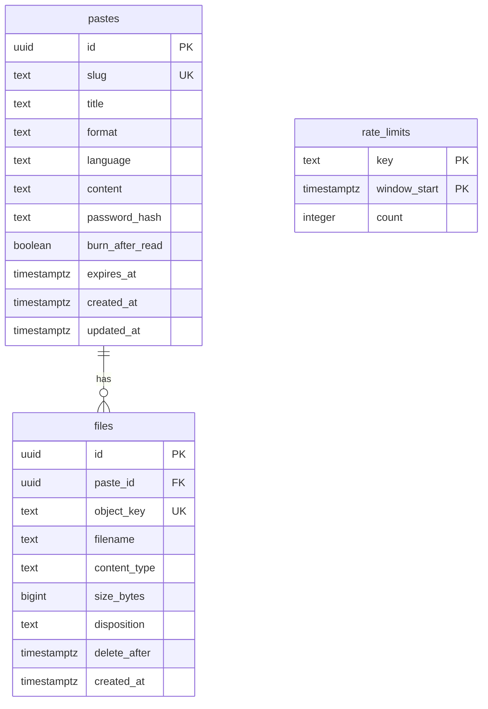

# Data model

Postgres holds metadata and text. R2 holds file bytes. The app will define this schema with Drizzle, and the SQL below is the reference for what it must produce.

## Overview



## Schema

```sql
CREATE TABLE pastes (
    id              uuid PRIMARY KEY DEFAULT gen_random_uuid(),
    slug            text NOT NULL UNIQUE
                    CHECK (slug ~ '^[a-z0-9]([a-z0-9_-]{0,62}[a-z0-9])?$'),
    title           text CHECK (char_length(title) <= 200),
    format          text NOT NULL DEFAULT 'text'
                    CHECK (format IN ('text', 'code', 'markdown')),
    language        text,
    content         text CHECK (octet_length(content) <= 1048576),
    password_hash   text,
    burn_after_read boolean NOT NULL DEFAULT false,
    expires_at      timestamptz,
    created_at      timestamptz NOT NULL DEFAULT now(),
    updated_at      timestamptz NOT NULL DEFAULT now()
);

CREATE INDEX pastes_expires_at_idx ON pastes (expires_at)
    WHERE expires_at IS NOT NULL;

CREATE TABLE files (
    id           uuid PRIMARY KEY DEFAULT gen_random_uuid(),
    paste_id     uuid REFERENCES pastes (id) ON DELETE SET NULL,
    object_key   text NOT NULL UNIQUE,
    filename     text NOT NULL CHECK (char_length(filename) <= 255),
    content_type text NOT NULL,
    size_bytes   bigint NOT NULL CHECK (size_bytes > 0),
    disposition  text NOT NULL CHECK (disposition IN ('inline', 'attachment')),
    delete_after timestamptz,
    created_at   timestamptz NOT NULL DEFAULT now()
);

CREATE INDEX files_paste_id_idx ON files (paste_id);
CREATE INDEX files_delete_after_idx ON files (delete_after)
    WHERE delete_after IS NOT NULL;

CREATE TABLE rate_limits (
    key          text NOT NULL,
    window_start timestamptz NOT NULL,
    count        integer NOT NULL DEFAULT 1,
    PRIMARY KEY (key, window_start)
);
```

## Field notes

### `pastes`

| Field | Notes |
|---|---|
| `slug` | Stored normalized. See [Routing](routing.md). |
| `format` | Controls rendering. A files-only paste keeps the default `text`. |
| `language` | Syntax highlighting language, used when `format` is `code` |
| `content` | Null for files-only pastes. The API rejects a paste with neither content nor files. |
| `password_hash` | scrypt hash, null when the paste has no password |
| `expires_at` | Null means the paste never expires |

### `files`

| Field | Notes |
|---|---|
| `paste_id` | Null until the file is attached, and again after its paste is removed |
| `object_key` | `files/{id}`. User-supplied filenames never appear in keys. |
| `filename` | Original name, shown to users and used for downloads |
| `content_type` | Declared type if it's on the safe list, otherwise `application/octet-stream` |
| `disposition` | `inline` for safe media, otherwise `attachment`. See [Security](security.md#malicious-uploads). |
| `delete_after` | When cleanup may remove the file. Null means the file is in use. |

### `rate_limits`

Each row counts attempts for one key during one time window. `key` looks like `login:{ip}` or `unlock:{slug}:{ip}`. Increments use `INSERT ... ON CONFLICT DO UPDATE`, and cleanup removes old windows.

## File lifecycle

`delete_after` is the single rule for removing file bytes. Every way a paste can go away (delete, expiry sweep, slug-reuse delete and burn) goes through one `removePaste` helper that sets it, so no path can leave files with `paste_id` and `delete_after` both null.


| Event | `paste_id` | `delete_after` |
|---|---|---|
| Upload requested | Null | Now + 24 hours |
| Attached to a paste | Paste ID | Null |
| Paste deleted or expired | Null | Now |
| Paste burned | Null | Now + 65 minutes |

The 65-minute delay on burned pastes lets signed links finish working: 5 minutes for downloads and 1 hour for inline media. Cleanup deletes the R2 object first and the database row second, so a failure can't leave an untracked object behind.

## Atomic burn

One statement removes the paste, releases its files and returns everything needed for the response:

```sql
WITH burned AS (
    DELETE FROM pastes
    WHERE id = $1
      AND (expires_at IS NULL OR expires_at > now())
    RETURNING id, title, format, language, content
),
released AS (
    UPDATE files
    SET delete_after = now() + interval '65 minutes'
    WHERE paste_id IN (SELECT id FROM burned)
    RETURNING id, object_key, filename, size_bytes
)
SELECT
    burned.*,
    COALESCE(
        (SELECT json_agg(released) FROM released),
        '[]'::json
    ) AS files
FROM burned;
```

If two people reveal at once, only one `DELETE` removes the row. The other gets no rows and returns `404`.

## Object storage layout

```text
bucket: pastekar-files
└── files/
    └── {file-uuid}
```

Each object stores its `Content-Type` and `Content-Disposition`, which are set when the signed upload URL is created.

## Storage limit

`POST /api/uploads` sums `files.size_bytes`, including pending uploads, and rejects the request if it would exceed `MAX_TOTAL_STORAGE_BYTES`. The sum and the insert run in one transaction that first takes `pg_advisory_xact_lock`, so parallel uploads can't both pass the check.
